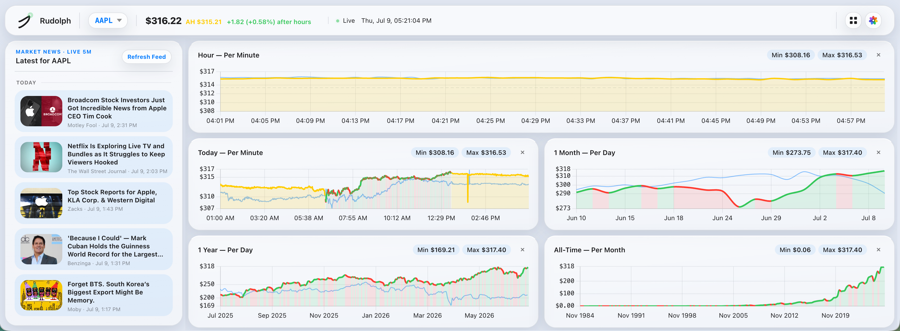

# Rudolph

<p align="center">
  
</p>

A customizable market dashboard for every new tab, built with [WXT](https://wxt.dev), React, and TypeScript. Rudolph shows live quotes, extended-hours movement, contextual news, Chrome bookmarks, and movable, resizable chart widgets without a backend service.

## Bootstrap

Use Node.js 22.12 or newer and npm. Python 3 is needed only for the packaging and release scripts.

```bash
npm ci
npm run dev
```

WXT prepares generated types during installation, builds a development extension, and opens a browser with hot reload. Its browser startup configuration includes `--disable-features=MacAppCodeSignClone` to avoid implicit clone storage buildup on macOS.

For an existing browser profile or manual extension loading:

```bash
npm run dev:manual
```

Open `chrome://extensions`, enable **Developer mode**, select **Load unpacked**, and choose `.output/chrome-mv3-dev`. Open a new tab. Keep the dev server running for hot reload.

To use a production build:

```bash
npm run build
```

Load `.output/chrome-mv3` through **Load unpacked**. Reload the extension card after rebuilding. The repository root is no longer an installable extension; WXT generates the manifest and `newtab.html` in the output directory.

## Architecture

```text
wxt.config.ts                  WXT, React module, browser startup, permissions
package.json / package-lock.json  Versioned dependency and script definitions
src/
  entrypoints/newtab/           HTML entrypoint, React root, and App
  components/                  Header, ThemeMenu, DashboardWorkspace/chart widgets
  theme/                       Typed preferences and React ThemeProvider/useTheme
  assets/styles.css            Existing theme tokens and dashboard styles
  legacy/dashboard.js          Lifecycle adapter for data, charts, grid, and bookmarks
public/icons/                  Static extension icons copied by WXT
test/                          Existing behavior and packaging regressions
```

WXT uses its official `@wxt-dev/module-react` module and file-based new-tab entrypoint. Source modules and CSS are bundled locally; extension pages do not load executable code from a CDN. `public/` contains only static assets. Permissions are defined in `wxt.config.ts`; the generated manifest stays out of source control.

React owns the page shell, reusable widget markup, theme controls, and appearance state. `ThemeProvider` preserves existing local preference keys, migrates previous light/dark preferences, follows system appearance in **Auto**, and synchronizes changes across open tabs. `ThemeMenu` uses controlled state and native buttons with pressed states, outside-click dismissal, and Escape/focus handling. Theme selection does not remount the dashboard or interrupt pending data requests.

The existing chart, news, watchlist, bookmarks, and GridStack behaviors live in an explicit adapter while those features are migrated to React components incrementally. Stable memoized components give the adapter ownership of chart/news leaf content and widget positions. Each mount creates fresh runtime state; cleanup aborts requests, clears timers and animation frames, removes listeners, destroys charts and GridStack, and removes temporary tooltips and popovers. The adapter is loaded asynchronously after the shell renders; importing it starts no data loading or DOM work.

Header, news, and chart skeletons reserve space while requests run independently. The page controls are available immediately, without waiting for an all-page loading overlay.

## Features

- Live watchlist with search and removable tracked symbols.
- Regular and extended-hours quote summaries and chart segments.
- Hour, day, month, year, and all-time Chart.js views.
- Draggable, resizable, hideable GridStack widgets with saved layouts.
- Contextual news with manual and five-minute refresh and older-story loading.
- Chrome bookmark menu with recursively nested folders.
- Six existing theme families with independent **Auto**, **Light**, and **Dark** appearance controls.

## Data and privacy

Quotes and fresh headlines come from Yahoo Finance; older headline history comes from Google News. Only their public hosts are granted access in `wxt.config.ts`. API requests retain bounded retries, exponential backoff with jitter, provider cooldowns, and `Retry-After` handling. Each request has a 15-second deadline covering its response body, polling jobs cannot overlap themselves, and per-provider response caches are bounded. Failed requests leave usable controls and unavailable states. The existing hourly demo fallback is retained and explicitly labels its synthetic quote as **demo**; it is not a live market quote.

The extension requests only the `bookmarks` permission. Bookmarks stay in Chrome and are neither transmitted nor persisted by Rudolph. External article and bookmark URLs are validated, and links opened in a new tab use `noopener noreferrer`. The old third-party CORS proxy fallback has been removed. Live data and bookmarks should be verified inside the extension; an ordinary HTTP preview lacks extension host permissions and the Chrome Bookmarks API.

Layout, watchlist, theme, and appearance preferences remain in local browser storage. This repository is public and personal: keep private links, credentials, company-specific configuration, customer data, and personally identifiable information out of source and test fixtures.

## Verification

```bash
npm run check
npm test
npm run build
npm audit
```

The regression suite covers existing extended-hours calculations, provider backoff, saved layouts, URL/news handling, theme tokens, runtime disposal, and packaging. New regression tests focus on lifecycle cleanup and preventing source/private files from entering the extension ZIP.

For a manual smoke test, load the production extension, switch theme families and appearance, reload a tab to check persistence, search/select a symbol, close and restore a chart, resize a widget, refresh news, and navigate a nested bookmark folder. The theme menu should work even when data is unavailable. For any Playwright browser simulation, pass `--disable-features=MacAppCodeSignClone` in browser launch arguments.

## Packaging and releases

`VERSION` and `package.json` must contain the same semantic version. WXT derives the generated manifest version from `package.json`. Version **1.2.0** introduces the WXT/React foundation.

```bash
npm run zip
# dist/Rudolph-<version>-chrome-extension.zip
```

`package.sh` builds the production extension, verifies all version values, and packages only `.output/chrome-mv3`. It rejects symlinks and atomically replaces the ZIP after validation.

Preview the existing signed release process:

```bash
./release.sh --dry-run
```

When publishing a release, provide `GITHUB_TOKEN` through your environment and run `./release.sh`. The script verifies semantic versions, creates and verifies a signed `v<VERSION>` tag, pushes it, and uploads the single extension ZIP to a GitHub release. A release publishes externally; local build, test, and packaging commands do not publish anything.
